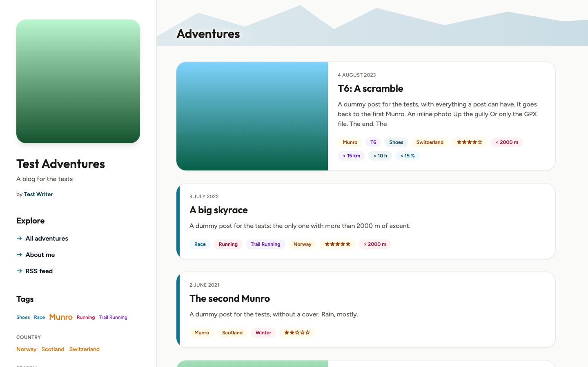
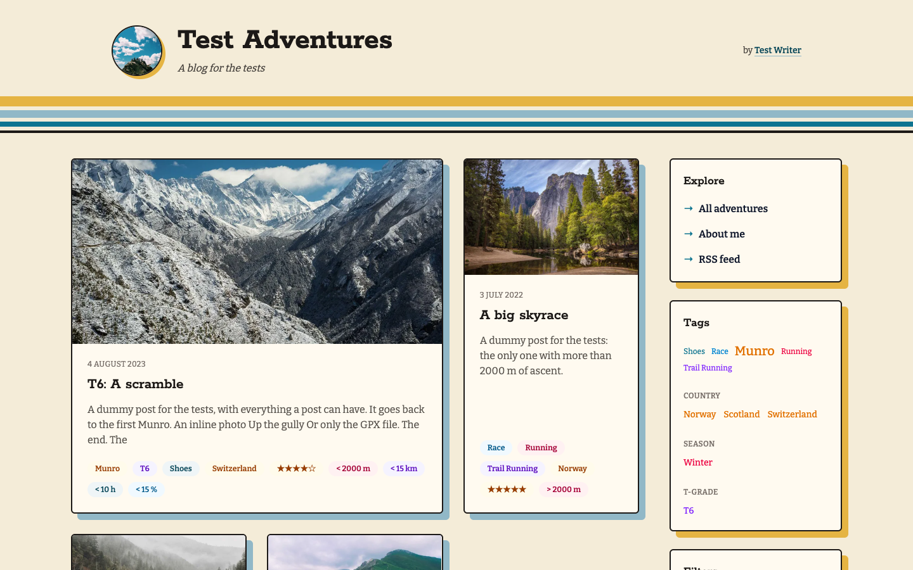
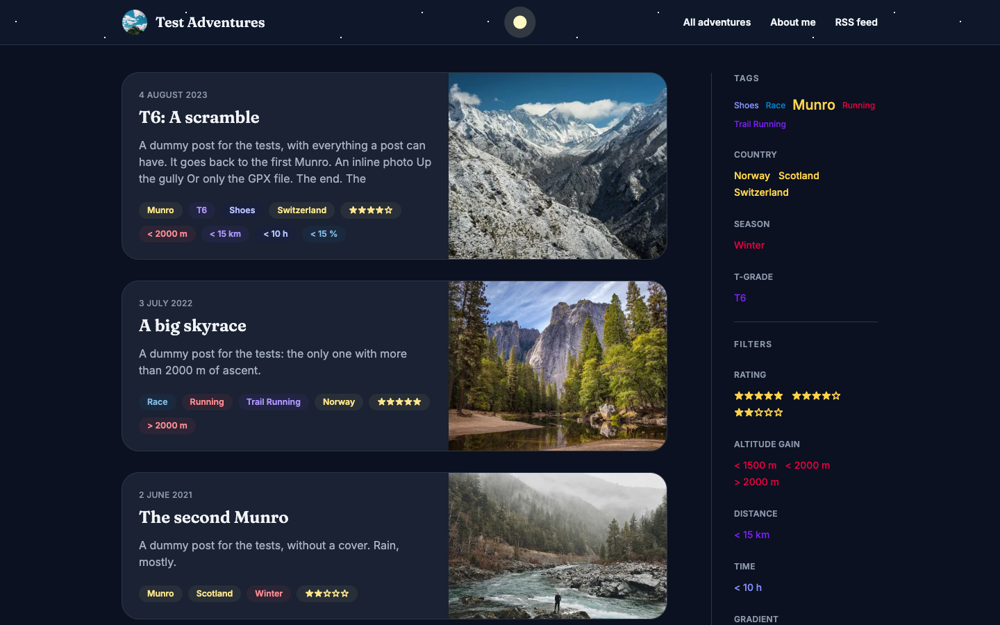

# cowtent-core

**cowtent** = cow + tent = content, the platform of an outdoor blog. Markdown posts with photos, a gallery,
facts (distance, ascent, time), checklists, a post's routes on OpenStreetMap, in 3D too, with their points and photos, tags and filters, themes, an RSS feed,
prerendered to a static site. Ember 7 (compatless) on Vite, WarpDrive,
Tailwind CSS 4.

A blog is a separate repository with only the writing in it (see
`cowtent-starter`): it depends on this package and builds with it.

All of it, code and design, is MIT (LICENSE). The fonts, Inter, Fraunces,
Outfit, Figtree, Rokkitt and Bitter, are under the SIL Open Font License
and installed from npm. The photos of the dummy blog of the tests are from
Lorem Picsum, under the Unsplash License (tests/fixtures/PHOTOS.md).

Version 0.4.1, see [CHANGELOG.md](CHANGELOG.md).

## Screenshots

The front page of the dummy blog of the tests (`tests/fixtures/content/`)
in each theme.

### alps



### basecamp



### night



## A blog's folder

```
site.yaml               title, owner, menu, language, theme, colours
                        (lib/site.mjs)
languages/<code>.yaml   tag names, and any of the core's words reworded
cover.jpg               the sidebar photo
favicon.svg             optional, the icon of the site and the app
posts/<slug>/index.md   a post at /<slug>, its photos next to it
posts/<slug>/cover.jpg  its cover: "cover - The ridge at dawn.jpg", the rest the alt text
posts/<slug>/gallery/   its gallery: "01 - The view.jpg", the name the caption
posts/<slug>/route.gpx  its route on the map above the gallery, with its points and photos
pages/<slug>/index.md   a page at /page/<slug>
public/                 optional, copied as is
```

Its `package.json`:

```json
{
  "scripts": {
    "build": "pnpm update cowtent-core && cowtent build",
    "start": "cowtent start"
  },
  "dependencies": {
    "cowtent-core": "github:vast-ch/cowtent-core"
  },
  "packageManager": "pnpm@10.34.9"
}
```

- `cowtent start` - dev server on http://localhost:4200
- `cowtent build` - the site in `dist/`, every page prerendered, plus
  `404.html`; then it checks every post and page made it in, with its
  photos, links and feed (`tests/output/site.test.mjs`), and fails if not

## Where it runs

A blog can live at the root of its host or under a path, like
`https://vast-ch.github.io/cowtent-starter`. The build takes the path from
the blog's address (`url:` in site.yaml, or the one its host gives the
build: `SITE_URL` from the GitHub Pages workflow, Netlify's `URL`, Vercel's
production domain, Render's address; Cloudflare Pages has none, a blog
there writes `url:`) and uses it for the assets, the app's routes, the
links, the feed and the installed app (`site.base`, lib/site.mjs). The
production build of the test blog runs under `/trips/`, and
`tests/output/site.test.mjs` checks every link stays under it.

Whatever the host needs beyond the files comes with the build, so a
blog's own host settings are only its build command (`pnpm build`) and
folder (`dist`), and a change reaches every blog with its next build
(lib/host.mjs):

- The Content-Security-Policy is a `<meta>` in every page, with the
  hashes of the page's own inline scripts: every host applies it, GitHub
  Pages too.
- `dist/_headers` caches the fingerprinted assets forever and lets other
  sites load a GPX; Netlify and Cloudflare read it.

A blog's `package.json` builds with `pnpm update cowtent-core && cowtent
build`, so that a host that keeps `node_modules` between builds still
gets the newest cowtent-core.

## Languages

Every word around the posts is in `languages/<code>.yaml` here (`en`,
`de`), grouped by where it shows up: `sidebar`, `post.facts`,
`post.gallery`, `filters`... A blog picks one with `language:` in its
site.yaml, and its own `languages/<code>.yaml` has the names of its tags
under `tags:` and can reword any of the core's words: its keys win, the rest
comes from here (lib/language.mjs). A new language is a new file here with
every key of en.yaml (`tests/lib/language.test.mjs` checks).

## Themes

`theme:` in site.yaml picks the look, `alps` when it has none:

- `alps` - the sidebar on the left with the big photo, the name and the
  tagline; the outline of the Alps over the page with where on the blog it
  is, and under it the title of the post or page, smaller, as the page
  scrolls; one post a row with its photo on the left
- `basecamp` - an old camping poster: slab fonts on cream paper, the
  name across the top over the stripes of a 70s sunset, the posts as a
  showcase of stickers with hard shadows in three columns, the sidebar on
  the right in stickers too
- `night` - dark, with a menu bar under the stars: a small photo, the name
  and the links; one post a row with its photo on the right, the tags and
  filters in a column beside them

A theme is a folder in `app/themes/`, listed in `app/themes/index.ts` and
`lib/themes.mjs`. It draws the parts of the page its own way as templates:
`layout.gts`, the frame of every page (header, sidebar, footer), and
`post-list.gts`, the posts on the front page. They're built from the shared
components (`app/components/`: the post cover, its tags, the sidebar's
sections), and the posts and pages themselves are the same in every theme.
A theme has no CSS: everything is Tailwind classes in its templates, its
fonts and colours too, which its layout sets on `<html>` while it's on the
page (`[:root:has(&)]:[--font-display:…]`).

A page is prerendered in the blog's theme. With `theme-switcher: true`
visitors can pick another one at the end of the sidebar: the page changes on
the spot, their browser remembers it for that blog, and on their next page
it replaces the blog's theme as soon as the app has started.

## Releasing

Blogs aren't pinned to a version: every build of every blog installs the
core from `main`, and the starter has no lockfile. A commit on `main` reaches
all of them on their next publish (after their next commit, or on Monday).
The people writing the blogs only edit Markdown and YAML; they never update
anything themselves. A version (package.json, CHANGELOG.md) is a tag
`v<version>` and a GitHub release with its CHANGELOG entry.

## Working on it

`pnpm test` runs the acceptance tests against the dummy blog in
`tests/fixtures/content/`. `pnpm build` builds that one too (or any other
with `BLOG_CONTENT=../cowtent-starter pnpm build`).

To see a change on a real blog as you make it, serve the blog from this
folder: the core's own code, no install in the blog and nothing to publish.

```sh
BLOG_CONTENT=../cowtent-starter node bin/cowtent.mjs start
```

`pnpm screenshots` makes the screenshots above anew from the dummy blog, in
the Chrome that's installed, and overwrites `docs/screenshots/`
(`scripts/screenshots.mjs`). A new theme gets its screenshot by itself; its
heading and image in this README are added by hand.
