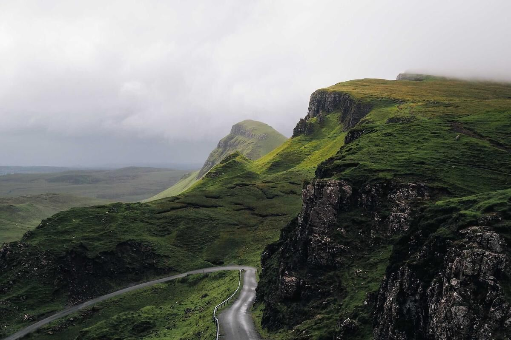

A dummy post for the tests, with everything a post can have. It goes back to [the first Munro](../2020-05-01-first-munro/index.md).



## The route


Or only [the GPX file](./route.gpx).

## What worked

- [x] **Microspikes**
      Grip all the way up the snowfield.
- [-] No ice axe
- [+] An early start
- [ ] Bring a map
- [?] Was the gully easier?
- [!] Rockfall after noon
- [i] The hut opens in June
- [*] The best view of the year
- [z] An unknown symbol stays text
- A plain bullet

## The route

The end.

The settings that made it work:

```yaml title="gear.yaml"
spikes: true
```
